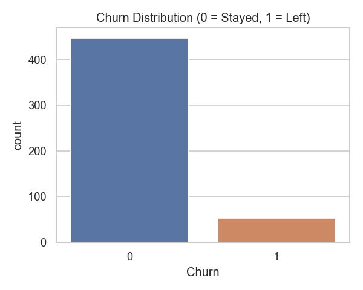
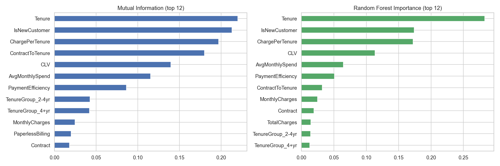
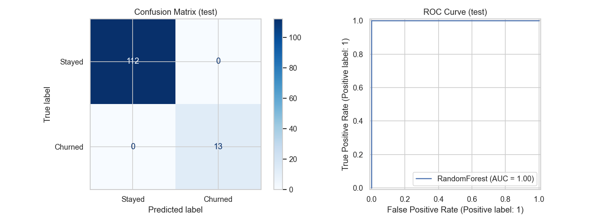

# Customer Churn Prediction — Preprocessing & Feature Engineering

Week 10 project: preprocess customer data, engineer features, and build a model that predicts which customers are likely to leave.

## Project structure
```
├── churn_prediction_pipeline.ipynb      # main notebook (Day 1 → Day 7 + tests)
├── churn_data.csv                       # dataset (500 rows)
├── preprocessing_report.md              # every preprocessing step + rationale + results
├── feature_engineering_documentation.md # the 9 engineered features
├── requirements.txt
├── images/                              # plots saved by the notebook
└── churn_pipeline.joblib                # trained pipeline (created when notebook runs)
```

## Setup
```bash
python -m venv venv
venv\Scripts\activate          # Windows   |   source venv/bin/activate  (Mac/Linux)
pip install -r requirements.txt
```
Open `churn_prediction_pipeline.ipynb` in VS Code → select the `venv` kernel → **Run All** (or Shift+Enter cell by cell).

## What's covered
| Requirement | Where |
|---|---|
| ≥ 3 encoding methods | Label, Ordinal, One-Hot, Frequency — Day 2 |
| 2 scaling techniques | Min-Max vs Standard — Day 3 |
| Outlier detection | IQR + Z-score, `IQRCapper` — Day 4 |
| 5+ engineered features | 9 features — Day 5 |
| Feature selection | Correlation, Mutual Info, RF importance, ANOVA F — Day 6 |
| Complete pipeline | `FeatureEngineer → ColumnTransformer → RandomForest` — Day 7 |
| Testing | Assertions + new-customer predictions — "Testing & Validation" |

## Results
Random Forest: CV ROC-AUC 0.992, test accuracy 0.97, churn recall 1.00.

## Screenshots



